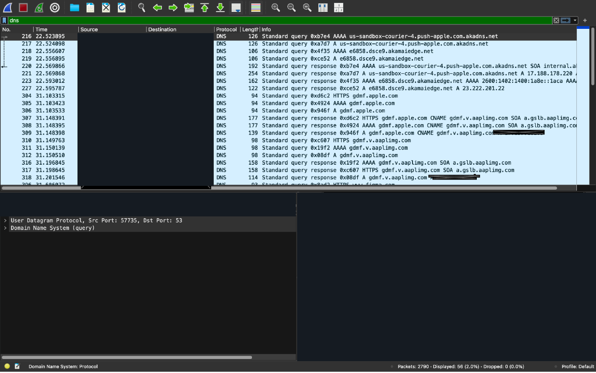
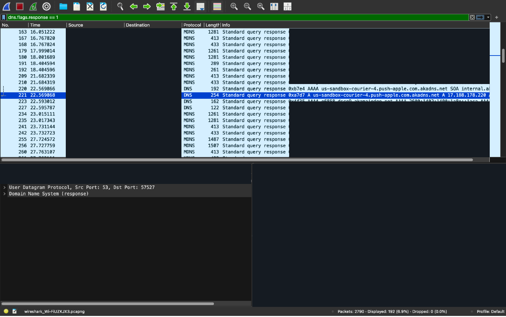
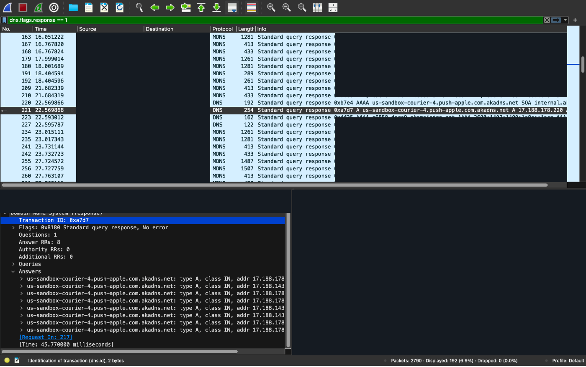
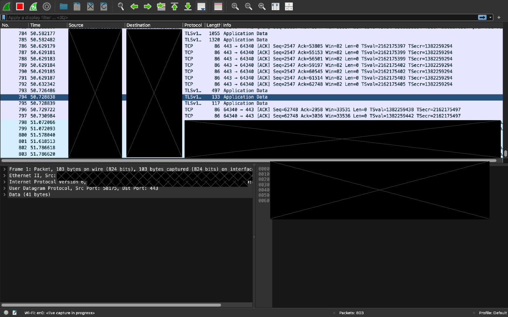

# Wireshark DNS Traffic Analysis

## Project Overview

This project documents a hands-on network traffic investigation performed using **Wireshark on macOS**. The objective was to capture and inspect live network traffic, examine DNS queries and responses, analyze domain name resolution, measure DNS response times, and investigate DNS error responses.

The investigation also included observing TCP and TLS traffic to develop practical experience with network packet inspection.

This project demonstrates foundational skills relevant to **Security Operations Center (SOC) analysis, network troubleshooting, and cybersecurity investigations**.

## Lab Environment

| Component | Description |
|---|---|
| Operating System | macOS |
| Analysis Tool | Wireshark |
| Network Interface | Wi-Fi (en0) |
| Capture Format | PCAPNG |
| Traffic Source | Local network capture |
| Protocols Observed | DNS, mDNS, TCP, TLS |

## Objectives

1. Capture and inspect live network traffic using Wireshark.
2. Identify DNS queries and their corresponding responses.
3. Examine DNS A and AAAA resource records.
4. Correlate DNS requests and responses using transaction identifiers.
5. Measure DNS response times.
6. Identify DNS responses containing nonzero error codes.
7. Observe TCP and TLS traffic.
8. Document findings and explain their security relevance.

## Methodology

### 1. Network Traffic Capture

Captured live network traffic using Wireshark on the macOS Wi-Fi interface (`en0`).

The capture contained **2,790 packets**, providing traffic for protocol inspection and DNS analysis.

### 2. DNS Traffic Filtering

Applied the Wireshark display filter:

`dns`

This isolated DNS-related traffic, including DNS and mDNS packets. A total of **56 packets** were displayed.

Examined DNS requests for A (IPv4) and AAAA (IPv6) records associated with Apple and Akamai services.

### 3. DNS Response Identification

Applied the display filter:

`dns.flags.response == 1`

This isolated DNS response packets for further examination.

Selected DNS response packet **221** and inspected its Domain Name System details.

### 4. DNS Request and Response Correlation

Identified packet **217** as the corresponding DNS request for response packet **221**.

The request and response shared the transaction identifier:

`0xa7d7`

Wireshark reported a DNS response time of **45.77 milliseconds**.

### 5. DNS Error Analysis

Applied the display filter:

`dns.flags.rcode != 0`

This filter identifies DNS packets containing nonzero response codes.

No matching packets were displayed during this investigation.

### 6. TCP and TLS Traffic Inspection

Examined additional captured traffic containing TCP acknowledgment packets and TLS application data.

Observed packet lengths, protocol identification, TCP sequence and acknowledgment information, and traffic timing.

This provided additional exposure to common network protocols beyond DNS.

## Findings

| Observation | Result |
|---|---|
| Total packets captured | 2,790 |
| DNS/mDNS packets displayed | 56 |
| DNS request packet | 217 |
| DNS response packet | 221 |
| DNS transaction ID | 0xa7d7 |
| DNS response time | 45.77 ms |
| DNS record type analyzed | A (IPv4) |
| Answer records returned | 8 |
| DNS response status | No error |
| Nonzero DNS response codes observed | 0 |

### DNS Resolution Analysis

A DNS query requested an IPv4 address for an Apple-related service domain.

The corresponding DNS response returned **eight A records**, providing IPv4 addresses associated with the requested domain.

The matching transaction identifier and Wireshark's request-response correlation allowed the DNS resolution process to be examined.

The selected DNS transaction completed successfully with a response time of approximately **45.77 milliseconds**.

### IPv4 and IPv6 DNS Records

The capture included both A and AAAA DNS records.

- **A records:** Map domain names to IPv4 addresses.
- **AAAA records:** Map domain names to IPv6 addresses.

Observing these records provided practical experience identifying different DNS resource record types and understanding their roles in network communication.

### DNS Error Analysis

The display filter `dns.flags.rcode != 0` returned no matching packets in the analyzed capture.

No nonzero DNS response codes were observed.

This does not establish that the entire network was free of DNS issues; it reflects the traffic available within the capture.

### TCP and TLS Observations

The captured traffic also contained TCP acknowledgment packets and TLS application data.

These packets demonstrated normal protocol structures associated with network communication.

No determination of malicious activity was made from the TCP/TLS screenshot alone.

## Screenshots and Evidence

The following screenshots document the original Wireshark capture and analysis. Sensitive network identifiers and raw packet bytes have been redacted to protect privacy.

### Screenshot 1: DNS Queries

**Analysis:**

Applied the `dns` display filter to examine DNS-related network traffic.

Observed queries requesting A and AAAA records for domains associated with Apple and Akamai services.

This screenshot demonstrates the ability to isolate DNS traffic and identify DNS query types.

### Screenshot 2: DNS Responses

**Analysis:**

Applied the `dns.flags.response == 1` display filter to identify DNS response packets.

Observed DNS responses containing resource records and corresponding transaction identifiers.

This screenshot demonstrates DNS response filtering and initial packet correlation.

### Screenshot 3: DNS Response Details

**Analysis:**

Expanded the DNS protocol details for response packet **221** and identified its relationship to request packet **217**.

Key observations:

- Transaction ID: `0xa7d7`
- DNS Response Status: No error
- Record Type: A (IPv4)
- Answer Records: 8
- Response Time: 45.77 ms

This screenshot provides evidence of packet-level DNS analysis, request-response correlation, and DNS resolution timing.

### Screenshot 4: TCP and TLS Network Traffic

**Analysis:**

Observed TCP acknowledgment packets and TLS application data within the captured network traffic.

Examined packet lengths, TCP sequence and acknowledgment information, and protocol identification.

This screenshot demonstrates general network traffic inspection and familiarity with TCP and TLS packet structures.

## Security Relevance

DNS analysis is an important component of network monitoring and security investigations.

Security analysts may examine DNS traffic to identify:

- Unusual or unexpected domain name lookups.
- Repeated DNS resolution failures.
- Suspicious or potentially malicious domains.
- Possible command-and-control communication patterns.
- DNS configuration problems.
- Network connectivity and name resolution issues.

Analyzing DNS requests, responses, transaction identifiers, and response times can help analysts understand network behavior and identify activity requiring further investigation.

**No confirmed malicious DNS activity was identified during this limited investigation.**

Additional packet captures, contextual information, endpoint telemetry, and threat intelligence would be necessary to make broader security conclusions.

## Skills Demonstrated

- Network traffic capture and inspection
- Wireshark display filtering
- DNS protocol analysis
- DNS request and response correlation
- DNS A and AAAA record identification
- IPv4 and IPv6 fundamentals
- DNS response time analysis
- DNS error code investigation
- TCP and TLS traffic observation
- Network troubleshooting fundamentals
- Technical documentation
- Security-focused network analysis
- Sensitive information redaction

## Future Improvements

Future investigations will expand on this foundational analysis by:

1. Comparing DNS A and AAAA responses in greater detail.
2. Examining TCP three-way handshakes and connection termination.
3. Investigating TLS handshake messages and certificate information.
4. Analyzing DNS response failures in a controlled lab environment.
5. Practicing additional Wireshark display filters.
6. Expanding screenshot evidence with documented protocol analysis.
7. Investigating simulated suspicious network activity in an authorized lab.

## Privacy and Data Handling

All screenshots originate from network traffic captured and examined during this lab.

Sensitive network identifiers have been redacted before publication.

Raw PCAPNG capture files are not publicly distributed because they may contain device identifiers, network addresses, and other sensitive traffic metadata.

The published screenshots are intended to demonstrate the analysis process while protecting local network information.

## Conclusion

This project provided practical experience capturing and examining network traffic using Wireshark.

Through DNS filtering, packet correlation, response analysis, and error-code inspection, I developed a better understanding of how DNS resolution appears at the packet level.

The investigation also introduced additional TCP and TLS traffic inspection techniques.

This lab represents an initial step toward developing the network analysis and investigative skills used in cybersecurity operations, incident response, and network security monitoring.
